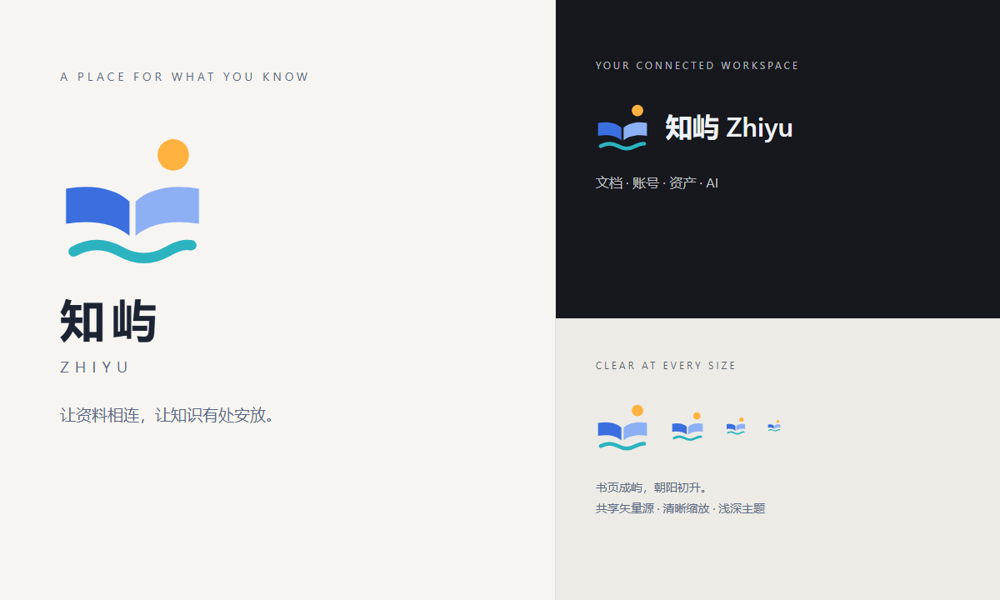

# 知屿 Zhiyu

知屿 Zhiyu 是连接文档、账号与数字资产的个人工作空间。应用界面、仓库介绍、下载页及新发行附件统一使用此名称。

1.9.0 起使用新标记：一本摊开的书像浮在海面的小岛，右上方一轮初升的太阳，前面一道海浪——「知」是书页，「屿」是海上的岛。标记没有底板，透明背景；书页蓝 `#3B6FE0` / `#8DB0F5`、朝阳橙 `#FFB23F`、海浪青 `#2BB3C0` 在浅色、深色背景和 Windows 任务栏上都能看清。源码中的同一几何与配色生成各平台尺寸，避免侧栏、任务栏和安装图标各自漂移。

- 矢量源：`src/lib/brand-mark.mjs`
- 界面标记：`src/components/logo.tsx`
- 图标生成：`node scripts/make-icon.mjs`
- 可复用文件：`public/brand/zhiyu.svg`、`public/brand/zhiyu.png`
- 视觉说明：`public/brand/zhiyu-preview.png`
- Windows：`build/icon.ico`，包含 16/24/32/48/64/128/256px PNG 图层
- 安装后的任务栏与快捷方式：统一使用 `resources/zhiyu.ico`；升级后刷新已存在的安装入口并通知资源管理器更新。
- 分享卡：`public/og.jpg`

标记为直接绘制的原创矢量设计，未使用生图工具。几何只有四个图形（两页书、太阳、海浪），16px 下仍可辨认；不加底板、描边或拟物阴影。1.2.2–1.8.x 使用的深青色底「双页成屿」标记已退役。

仓库使用 `Songwo/zhiyu`，下载页使用 `https://songwo.github.io/zhiyu/`。1.6.0 起安装包和插件采用 `Zhiyu-版本号-setup.exe`、`Zhiyu-版本号-browser-extension.zip`，程序名为 `Zhiyu.exe`，扩展目录为 `zhiyu-browser-extension`。

为保持升级与资料兼容，内部安装应用 ID、`Nanpad` 数据和会话目录、`nanpad://` 协议仍保留。不要手动重命名数据目录来改变显示品牌。Windows Shell 分组使用 `dev.songwo.zhiyu`，系统显示名为「知屿 Zhiyu」；开发版使用独立身份。历史提交、发布记录和实际旧附件文件名保留原状。
